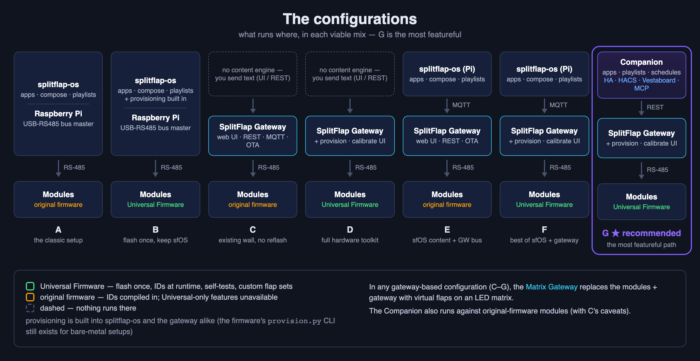

# Choosing a configuration

The stack is deliberately modular, and the pieces are swappable at two joints:

- **The module firmware** — Adam G Makes' **original firmware** (each module's bus ID is
  compiled in) or the **[Universal Firmware](Module-Firmware.md)** (one binary for every
  module, IDs assigned at runtime).
- **What drives the bus and provides content** — **[csader's splitflap-os](Using-splitflap-os.md)**
  on a Raspberry Pi (direct USB-RS485), the **[SplitFlap Gateway](SplitFlap-Gateway.md)** alone, **splitflap-os
  through the Gateway** (over MQTT), or the Gateway **plus the [Companion](Companion.md)**.

Every combination below is a working display. They differ in what you get around it —
and **Universal Firmware → Gateway → Companion is by far the most featureful path**,
which is why the [Quick Start](Quick-Start.md) walks that one.

## The configurations

### A / B — splitflap-os, direct (no Gateway)

The classic setup: a Raspberry Pi as bus master over USB-RS485, splitflap-os providing
the web UI, apps, compose and playlists. Entirely Gateway-free.

- **A — with the original firmware**: every module needs its own firmware build (the ID
  is compiled in).
- **B — with the Universal Firmware**: flash **one binary to every module** and assign
  IDs at runtime, straight from splitflap-os's own UI — provisioning is built into the
  product (the firmware's `provision.py` terminal tool is there if you prefer a
  shell). splitflap-os is compatible with both firmwares, so nothing else changes.

Either way you get its apps, compose grid, playlists, **schedules, event triggers and
quiet hours**. What it doesn't have: uploading your own apps from the browser, a
documented REST API, or the localization and Home Assistant surfaces the companion adds.

### C / D — Gateway alone (no content engine)

The ESP32 gateway as bus master: provision, calibrate, diagnose and drive the wall from
its web UI, REST API and MQTT, with OTA updates and quiet hours. No apps, playlists or
schedules — you send text yourself (browser, automation, anything speaking REST/MQTT).

- **C — with the original firmware**: display driving (text, characters, homing) **and the
  full calibration UI** — including the guided wizard — work, because calibration uses only
  original-protocol commands.² What you don't get is what depends on newer firmware:
  runtime provisioning, the module self-tests, and custom flap sets. Fine for an existing
  wall you don't want to reflash.
- **D — with the Universal Firmware**: the full hardware toolkit — everything in C, plus the
  provisioning UI, the self-tests and the flap-set editor.

### E / F — splitflap-os through the Gateway (over MQTT)

A hybrid: the **Gateway owns the bus**, and **splitflap-os provides the content**,
driving the display through the gateway's MQTT transport instead of a USB-RS485 adapter.
You get splitflap-os's apps, compose and playlists *plus* the gateway's web UI, REST
API, OTA and quiet hours — at the cost of running both a Pi and an ESP32.

- **E — with the original firmware**: the same firmware caveats as C.
- **F — with the Universal Firmware**: module provisioning and calibration now happen in
  the gateway's web UI — nicer than the terminal tool.

### G — Universal Firmware + Gateway + Companion ★ recommended

Everything in D, plus the whole content layer: the companion's own app
library (plus **your own uploaded apps**), playlists, schedules, triggers,
localization and resume-after-restart. On top of that come the interfaces only the
companion has: the [Home Assistant](Home-Assistant.md) sidebar app and HACS integration, the
[Vestaboard-compatible API](Vestaboard-API.md), and an [MCP server](MCP-Server.md) so an LLM can
read and drive the board.

*(The Companion also runs against original-firmware modules — the content layer doesn't
care — with the same hardware-tooling caveats as C.)*

> **No mechanical build?** In any gateway-based configuration (C–G), the
> **[Matrix Gateway](Matrix-Gateway.md)** (LED matrix) or the **[LCD Gateway](LCD-Gateway.md)**
> (integrated 10.1" touchscreen, Ethernet/PoE) substitutes for the modules *and* the gateway.

## Feature grid

| Feature | A Orig +sfOS | B Univ +sfOS | C Orig +GW | D Univ +GW | E Orig+GW +sfOS | F Univ+GW +sfOS | **G ★** **Univ+GW** **+Companion** |
|---|:-:|:-:|:-:|:-:|:-:|:-:|:-:|
| **Hardware you run** | Pi | Pi | ESP32 | ESP32 | ESP32 + Pi | ESP32 + Pi | ESP32 + Docker/HA host |
| Flash every module with one binary | — | ✅ | — | ✅ | — | ✅ | ✅ |
| Assign module IDs at runtime | — | ✅ (web UI) ¹ | — | ✅ (web UI) | — | ✅ (web UI) | ✅ (web UI) |
| Calibration tooling | ✅ | ✅ | ✅ (wizard) ² | ✅ (wizard) | ✅ (wizard) ² | ✅ (wizard) | ✅ (wizard) |
| Module self-tests (Hall / mechanical) | — | ⚠️ ³ | — | ✅ | — | ✅ | ✅ |
| [Custom flap character set](Flaps-and-Character-Sets.md) | — | ⚠️ ³ | — | ✅ (web UI) | — | ✅ (web UI) | ✅ (web UI) |
| [Flap count other than 64](Flaps-and-Character-Sets.md) | — | ⚠️ ³ | — | ✅ (web UI) | — | ✅ (web UI) | ✅ (web UI) |
| Live board preview in the browser | ✅ | ✅ | ✅ | ✅ | ✅ | ✅ | ✅ |
| Send text from the browser | ✅ | ✅ | ✅ | ✅ | ✅ | ✅ | ✅ |
| Compose — click-to-type grid, colour tiles | ✅ | ✅ | — | — | ✅ | ✅ | ✅ |
| Content apps (weather, stocks, …) | ✅ | ✅ | — | — | ✅ | ✅ | ✅ ⁷ |
| Upload your own apps from the browser (`.zip`) | — | — | — | — | — | — | ✅ |
| Playlists | ✅ | ✅ | — | — | ✅ | ✅ | ✅ (+ per-entry settings) |
| Run apps/playlists on a schedule | ✅ | ✅ | — | — | ✅ | ✅ | ✅ |
| Event triggers (ISS, games, weather) | ✅ | ✅ | — | — | ✅ | ✅ | ✅ |
| Localization (translated apps, locale formats) | — ⁸ | — ⁸ | — | — | — ⁸ | — ⁸ | ✅ |
| Quiet hours | ✅ | ✅ | ✅ | ✅ | ✅ | ✅ | ✅ |
| REST API | ⚠️ ⁴ | ⚠️ ⁴ | ✅ | ✅ | ✅ (gateway) | ✅ (gateway) | ✅ (gateway + companion) |
| MQTT + Home Assistant device | ✅ | ✅ | ✅ | ✅ | ✅ (both) | ✅ (both) | ✅ (both) |
| HA sidebar app + HACS entities | — | — | — | — | — | — | ✅ |
| [Vestaboard-compatible API](Vestaboard-API.md) | — | — | — | — | — | — | ✅ |
| [MCP server](MCP-Server.md) (LLM control) | — | — | — | — | — | — | ✅ |
| Update the bus controller over WiFi | — ⁵ | — ⁵ | ✅ | ✅ | ✅ ⁵ | ✅ ⁵ | ✅ |
| [Update the modules over the bus](Module-Firmware-Updates.md) | — | ⚠️ ⁹ | — ¹⁰ | ✅ | — ¹⁰ | ✅ | ✅ |
| Settings survive a host reinstall | — | — | ✅ ⁶ | ✅ ⁶ | ✅ ⁶ | ✅ ⁶ | ✅ (mirrored to the gateway) |
| Resume what was playing after a restart | — | — | — | — | — | — | ✅ |

**Notes**

1. In splitflap-os's own UI — provisioning is built into the product. (Older
   splitflap-os needed the `provision.py` terminal tool, which still ships with the
   [Universal Firmware](Module-Firmware.md) for anyone driving the bus by hand.)
2. **Calibration is fully compatible with the original firmware.** The gateway's Calibration
   tab — measure the revolution, set the home offset, nudge, set total steps, drive to a raw
   step, tune the per-flap map, and the guided wizard — issues only the original protocol's
   calibration commands (`c` `o` `s` `t` `g` `w` `h` `d`), and every EEPROM field it touches
   (home offset, total steps, the 64-entry flap map) is an original-layout field that has
   never moved. The only place the gateway's UI checks the firmware version at all is the
   flap-set editor (v31+).
3. **Reads, but can't write.** splitflap-os asks each module for its flap count and
   character set and encodes text against whatever it reports — so a reel that isn't the
   standard 64 works. But it has no way to *configure* one: writing the flap set to a
   module (the `N` command) is done from the gateway's web UI, or by hand over the bus.
   Self-tests are the same story — the firmware answers them; the gateway is the UI.
4. splitflap-os is a Flask app with HTTP endpoints its own UI calls (`/connection`,
   `/universal/*`, …), but there's no documented/public API. The gateway and the companion
   both ship one (the gateway's is documented in [Gateway API](Gateway-API.md)).
5. The gateway updates itself over WiFi from its own web UI; the Pi (the splitflap-os
   host) updates like any Linux box (`git pull` / reinstall).
6. Gateway settings (WiFi, MQTT, grid, calibration backup) live on the ESP32 itself;
   splitflap-os's own content settings live on its Pi.
7. The companion has **its own app library** (plus your own uploads) and runs apps in
   the splitflap-os plugin format unchanged — so splitflap-os apps drop in. The two
   libraries are separate and diverge; a companion app *may* run on splitflap-os,
   unoptimized and without its injected helpers, with no guarantees.
8. As of csader/splitflap-os `main` at the time of writing there are no language/locale
   settings — apps render in English. (Forks carrying i18n exist.) Note that localization
   is only half the problem: showing `É` also needs a reel with `É` printed on it, which is
   what the [flap-set](Flaps-and-Character-Sets.md) rows above are about.
9. Not from splitflap-os, but the firmware's own `tools/busflash.py` does it from any
   computer with a USB–RS485 adapter on the bus.
10. The original firmware has no bootloader, so its modules can only be flashed over UPDI.
   The Universal Firmware carries one from **v35**, and the modules need that version on
   them (one last UPDI flash) before the bus can do it.

## Switching later

The joints are designed so you can move along the grid without redoing everything:

- **A → B:** reflash the modules with the Universal Firmware (once each), provision IDs.
  Keep splitflap-os exactly as it is.
- **A/B → E/F:** add the Gateway as bus master and switch splitflap-os's transport to
  the gateway's MQTT. Modules untouched.
- **B/F → D/G:** the Gateway replaces the Pi's USB-RS485 on the same rail. Your modules,
  IDs and calibration are untouched — they live in the modules' EEPROM.
- **D → G:** run the Companion (Docker or the HA app) and point it at the gateway. The
  gateway keeps working standalone if the companion is down.
- **G without hardware:** swap modules + gateway for the
  [Matrix Gateway](Matrix-Gateway.md) or [LCD Gateway](LCD-Gateway.md); the companion can't tell.

---
**Next:** [Quick Start](Quick-Start.md) · [FAQ & Glossary](FAQ.md)
