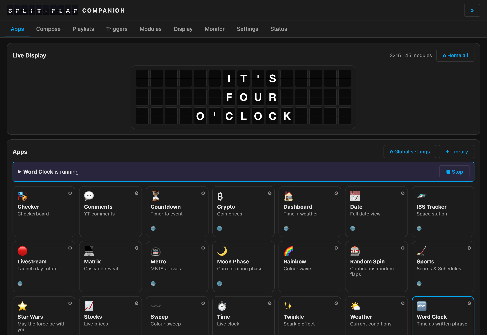
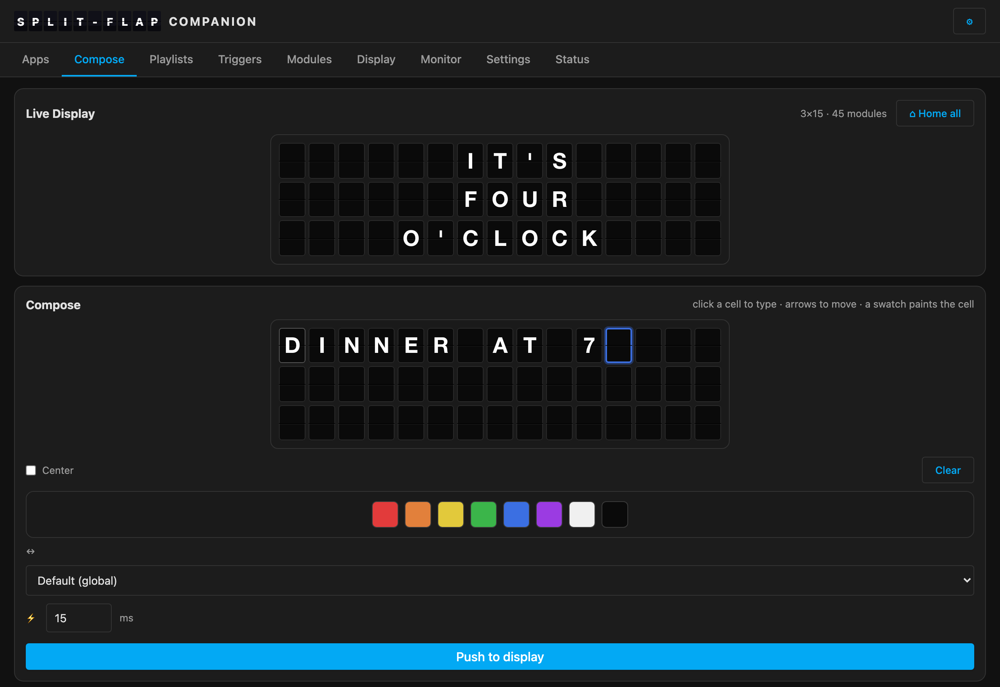
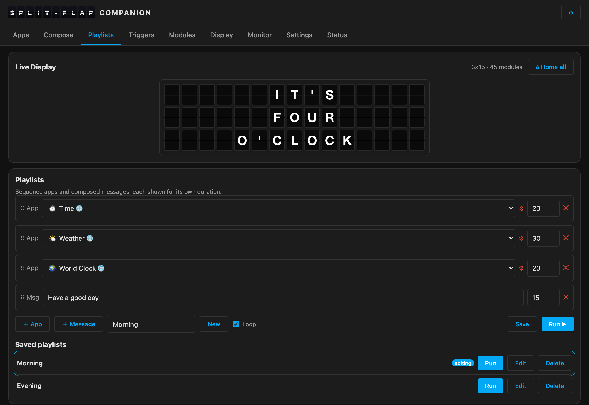
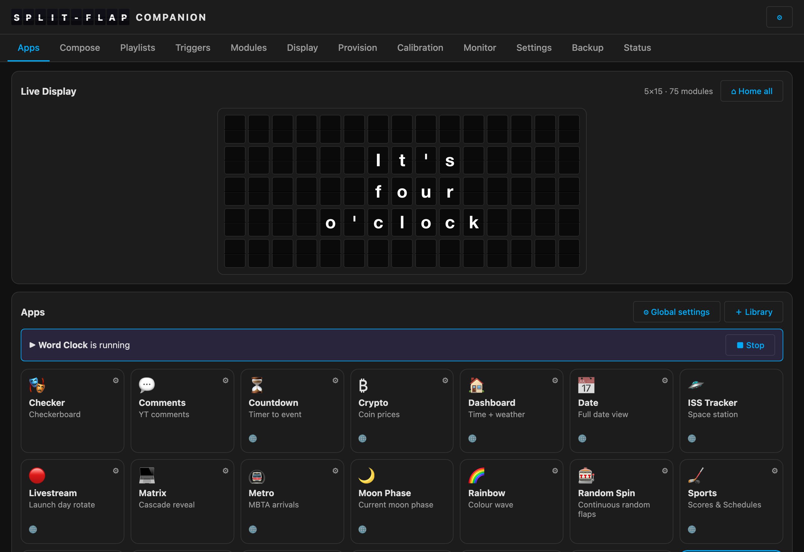

# Companion

The gateway can put any character on any flap — but *deciding* what to show is the
**Companion's** job. It's a web app that runs a library of **apps** (weather, clocks,
stocks, transit, sports, quotes, animations…), sequences them into **playlists**, runs them
on **schedules**, reacts to events with **triggers**, lets you **compose** a message by
hand, and mirrors the wall in a **live view**.

> **Repo:** [github.com/avandeputte/SplitFlapGatewayCompanion](https://github.com/avandeputte/SplitFlapGatewayCompanion)



It runs on a separate machine from the gateway (a Raspberry Pi, a NAS, a home server, or as
a Home Assistant app), and drives the display over the gateway's REST API. It's **optional** —
you can drive the gateway by hand or with [splitflap-os](Using-splitflap-os.md) — but it's where
the project comes alive.

## Install

The only thing you must configure is **`GATEWAY_URL`** — where your gateway is. The companion
reads the grid size and everything else from the gateway. It **refuses to start** without it.

> Use the gateway's **IP address**, not its `.local` name. The companion runs in a
> container, and containers frequently can't resolve mDNS names.
> → [Finding the gateway's IP](SplitFlap-Gateway.md#finding-it-on-your-network)

**Home Assistant** users: install it as an app — see
**[Home Assistant → The app](Home-Assistant.md#1-the-app-add-on)** for the step-by-step; it's
the easiest path and puts the UI in your sidebar.

**Docker** (anywhere else):

```bash
docker run -d --name splitflap-companion -p 8000:8000 \
  -e GATEWAY_URL=http://192.168.1.50 -v companion-data:/data \
  ghcr.io/avandeputte/splitflap-gateway-companion:latest
# then open http://<host>:8000
```

The image is multi-arch (x86 + arm64), so the same tag runs on a Pi or a PC. There's also a
one-line **install script** that sets up Docker and a compose project for you — that, the
compose file, and the full configuration reference are on
[Companion without Home Assistant](Companion-Standalone.md).

## What's in it

- **Apps** — a tile grid of the companion's own app library (the catalog:
  [Built-in Apps](Built-in-Apps.md)); apps in the [splitflap-os](Using-splitflap-os.md) plugin
  format drop in too. One tap
  runs an app; a live "▶ running" marker shows what's on. An **App Library** lets you add or
  remove apps, or **upload your own** as a `.zip` — the authoring guide is
  [Writing Apps](Writing-Apps.md).
- **Live view + Home all** — the board mirrors exactly what's on the wall, updated in real
  time. **⌂ Home all** returns every module home.
- **Compose** — a click-to-type grid with colour tiles and every transition style. Click a
  cell, type, and each keystroke lands on that module; push the whole grid to the wall.

  
- **Playlists** — sequence apps and messages with per-entry durations; save, run, loop. The
  same app can appear more than once with **different settings** (e.g. weather for two cities
  in two languages). **Edit** a saved playlist and the editor keeps its name, so saving your
  change is one click — you don't retype the name to overwrite it.

  
- **Schedules** — run an app or playlist, or turn the display off, in time-of-day windows per
  weekday, plus **quiet hours**.
- **Triggers** — apps that watch for something (the ISS passing overhead, a game, a weather
  change) and briefly **interrupt** the display, then let it resume.
- **Global settings** — **Language**, **Location** and **Timezone** at the top (they drive
  translations, date/number formats, currency and holidays for apps that adapt), then
  provider keys and defaults.

**Stop means stop.** When you stop an app or a playlist and nothing else is running, the wall
**blanks** rather than leaving the last thing it happened to be showing. A display with nothing
running shows nothing.

## Several displays

One companion can drive **several walls** — a split-flap in the living room and a Matrix Gateway
in the office, say. A switcher appears in the header as soon as there is more than one, and
each wall keeps its own apps, playlists, triggers and settings.

See **[Multiple Displays](Multiple-Displays.md)**.

## Localization

A global **Language** (US/UK/Australian English plus the major Western-European languages)
changes translated words, date order, number format and 12h/24h clock for any app carrying a
🌐 badge. **Currency and public holidays follow your Location** (down to province/state), not
the language — and both Language and Location are overridable **per app** and **per playlist
entry**, so one playlist can show Paris in French and Tokyo in Japanese back to back.

Whether those words can actually be *shown* depends on what's printed on your reels: `É` only
appears if a flap carries `É`. The [Universal Firmware](Module-Firmware.md) lets you print and
configure your own character set — see **[Flaps & character
sets](Flaps-and-Character-Sets.md)**.

## The wall decides the case

Apps write their words the way a person writes them — `Partly cloudy`, not `PARTLY CLOUDY`.
The companion **folds them to capitals on the way out**, and only for a wall with no lowercase
flaps. So one app feeds both kinds of display, and it is the display that decides how it looks.

Here is the same app, at the same minute, on two walls:

| a split-flap | a [Matrix Gateway](Matrix-Gateway.md) |
|---|---|
|  |  |

If you own a physical split-flap wall, none of this is visible to you — the output is plain
uppercase, just as a split-flap looks. On a Matrix Gateway you get the lowercase letters, the accents and the
[pictographs](Flaps-and-Character-Sets.md#the-extra-flaps-on-a-matrix-gateway) the emulated reel
carries.

Prefer it to shout anyway? **Always uppercase** in the global settings, per display.

## The gateway, in one place

Point the companion at your gateway and it **registers**: the gateway's own tabs (Modules,
Calibration, Settings…) appear right in the companion's nav, and as a Home Assistant app they
open inside the sidebar — so you configure the hardware without leaving the companion. See
[Gateway → the Companion tab](SplitFlap-Gateway.md#the-companion-tab).

## Bring your own apps

The apps are the [splitflap-os](Using-splitflap-os.md) plugin format — a `manifest.json` plus an
`app.py` (live/functional) or `data.json` (static/channel, or a **quiz** of question/answer
pairs). Upload a `.zip` from the App Library, or write your own; the companion runs them unchanged. (A functional app runs Python
on the companion host, so only upload apps you trust.)

## Ways to drive it from outside

Beyond its own UI, the companion exposes four interfaces. Each is independent — turn on the
ones you want, ignore the rest.

| | |
|---|---|
| **[REST API](https://github.com/avandeputte/SplitFlapGatewayCompanion)** | Its own JSON API — show text, run apps and playlists, read the board. |
| **[Vestaboard-compatible API](Vestaboard-API.md)** | Answers the **Vestaboard Local API**, so software written for a Vestaboard drives your wall unchanged — `ha-vestaboard`, scripts, Node-RED flows. |
| **[MCP server](MCP-Server.md)** | Exposes the display as **[MCP](https://modelcontextprotocol.io) tools**, so Claude (or any LLM client) can read the board and drive it in plain language — *"put standup on the board for 2 minutes, then put back what was playing."* |
| **[Home Assistant](Home-Assistant.md)** | A sidebar app, a HACS integration with real entities, and an MQTT device. |

The Vestaboard API and the MCP server are **not** Home Assistant features — they're plain
HTTP servers and work with or without it. Both are off by default; enable them and the keys
and addresses appear in the companion's **⚙ menu**.

---
**Next:** [Home Assistant →](Home-Assistant.md) · [Vestaboard API →](Vestaboard-API.md) · [MCP Server →](MCP-Server.md)
