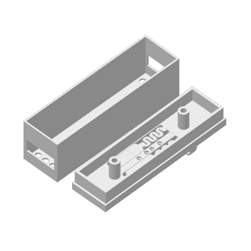

# Gateway case: clip the gateway onto the rail

The gateway does not have to sit beside the wall with wires running to it. This printed
case takes the Waveshare board **out of its stock enclosure**, clips it onto the same DIN
rail the modules use, and picks up power and the RS-485 bus from the conductor rail through
**four pogo pins** — exactly the way a module does. Snap it on and the gateway is on the bus.

> **The model:** [`SplitFlapGatewayCase.3mf`](https://github.com/avandeputte/SplitFlapGateway/blob/main/SplitFlapGatewayCase.3mf)
> in the gateway repo — a two-part print (base with the rail clip and pin holes, and a
> shell that covers the board), sized for the bare **ESP32-S3-RS485-CAN** PCB.

**What it takes:** the two printed parts, four pogo pins (the same ones the modules use —
see Adam's BOM in [Hardware](Hardware.md)), a few centimetres of thin wire, a dab of superglue,
a soldering iron, and a steady hand — the wires are soldered **directly to pads on the
Waveshare board**, and one of them carries the 12 V rail. Get that one wrong and the board
is gone, so read the wiring section twice.

---

## How it works

The modules' conductor rail carries four lines — **12 V, ground, RS-485 A and RS-485 B** —
and every module reaches them with pogo pins on its underside ([Hardware](Hardware.md)). The
gateway board needs exactly those four things: its power terminal accepts **7–36 V DC**, so
the 12 V rail feeds it directly, and its RS-485 terminal takes A and B. The case puts four
pogo pins in the base at the module's pin spacing so they land on the same four tracks, and
short wires bring each pin to the right point on the board.

One detail worth knowing: the Waveshare board's RS-485 port is **galvanically isolated** from
the rest of the board, with its own isolated ground. On the rail there is only one ground —
the 12 V supply's negative, which the modules' transceivers also reference — so both the
power negative **and** the RS-485 ground are tied to the rail's ground pin. That deliberately
defeats the isolation, which is fine here: the gateway and every module share the same
supply anyway.

---

## Wiring

| Rail track | Pogo pin | Solder to, on the Waveshare board |
|---|---|---|
| **12 V** | 1 | Power terminal **positive** (the terminal is rated 7–36 V DC) |
| **GND** | 2 | Power terminal **negative**, and the RS-485 terminal's **GND** |
| **RS-485 A** | 3 | RS-485 terminal **A+** |
| **RS-485 B** | 4 | RS-485 terminal **B−** |

The pin order in the base is **the same as a module's**, so the case seats on the rail the
same way round as the modules do. Hold a module next to the case, pins down, and match them
if you want to be sure.

The solder points are the **through-hole pads of the two screw terminals**, on the underside
of the PCB. The screw terminals themselves **stay on the board** — you solder to the pad
next to the terminal's pin, not into the terminal's cage.

### Preparing the board

1. Take the board out of the stock Waveshare enclosure. This case **replaces** it.
2. **Shorten the three indicator LEDs.** The PWR, RS485 and CAN LEDs stand on long legs so
   they reach the window of the stock enclosure; in this case they do not fit. Desolder each
   LED, trim its legs, seat it back down against the board, and resolder it — watch the
   polarity (the longer leg, or the flat on the lens, tells you which way it went). This is
   the only modification the board needs.

### The pins and the wires

3. Solder a short wire to the **top** (the tail) of each pogo pin **first**, while you can
   hold the pin freely.
4. Push the four pins into the holes in the base.
5. Add a **dab of superglue** at each pin so it cannot move or back out.
6. Solder the other end of each wire to its pad from the table above.
7. **Before powering anything**, check with a meter: continuity from each pogo pin to its
   pad, **no** continuity between the 12 V pin and any of the other three, and no bridge
   between the A and B pads.
8. Seat the board on the two posts, fit the shell, and clip the case onto the rail.

### First power-up

Clip it onto a rail that is powered and carrying modules. The board's **PWR** LED should
light from the rail alone — no USB, no separate supply. Then open the gateway's web UI: the
**RS485** LED blinks as it talks to the modules, and the Modules tab fills in.

---

## Printing

Two parts on one plate, about 88 × 24 mm in footprint: the base with the clip and pin holes,
and the shell. The `.3mf` is a Bambu Studio project and opens with its plate arranged;
any slicer that reads 3MF will take the meshes.

---
**Related:** [Hardware](Hardware.md) · [SplitFlap Gateway](SplitFlap-Gateway.md) · [Quick Start](Quick-Start.md)
