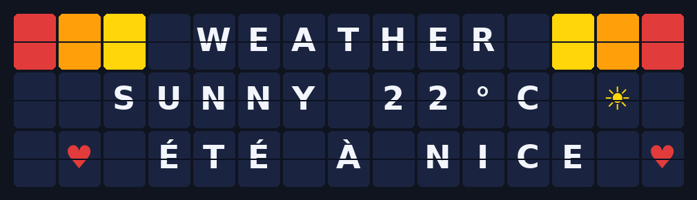

# Home Assistant

> **Applies to the physical SplitFlap Gateway only.** The Matrix Gateway removed its MQTT/HA
> surface in firmware 3.0 — see [Matrix Gateway](Matrix-Gateway.md). (The companion's own HA
> integrations, which talk to the companion rather than a gateway, work with both.)

The companion plugs into Home Assistant three ways, roughly from most to least integrated.
They're not exclusive — pick whichever suit you (the table at the bottom summarises which
does what).

Two further companion features are *reachable* from Home Assistant but aren't Home Assistant
features at all — they're plain HTTP servers that work with or without it, and they have their
own pages: the **[Vestaboard-compatible API](Vestaboard-API.md)** and the
**[MCP server](MCP-Server.md)**.

## 1. The app (add-on)

> In Home Assistant these are called **Apps** (also known as add-ons).

Runs the full [Companion](Companion.md) inside Home Assistant — in the sidebar, themed to match,
configured from the Configuration tab (no environment variables, no command line).

> **Requires a Supervisor install** — Home Assistant **OS** or **Supervised**. On Home
> Assistant **Container**/Core there is no App Store; run the
> [companion's Docker image](Companion.md#install) alongside HA and use the
> [HACS integration](#2-the-hacs-integration) below to connect them.

### Install it

1. **Settings → Apps → App Store.** *(If you don't see "Apps", your install has no
   Supervisor — see the note above.)*
2. Top-right **⋮** menu → **Repositories**. Paste:
   ```text
   https://github.com/avandeputte/SplitFlapGatewayCompanion
   ```
   → **Add** → **Close**. The store reloads with a **SplitFlap** section.
3. It offers two entries — **SplitFlap Gateway Companion** (stable) and **SplitFlap Gateway
   Companion (Beta)**. Pick **stable** unless you want prereleases. Both can be *installed*,
   but **both publish host port 8000, so only one can run at a time** — the second to start
   fails to bind. (To truly run both, remap the port on one: the App's Configuration tab →
   Network.)
4. **Install.** It downloads a prebuilt multi-arch image (`amd64`, `aarch64`) —
   there's no local build, so it's quick.
5. Open the **Configuration** tab and set **`gateway_url`** — the gateway's address, e.g.
   `http://192.168.1.42`. **Use the IP**, not the `.local` name: the App runs in a
   container that often can't resolve mDNS. (→ [Finding the gateway's
   IP](SplitFlap-Gateway.md#finding-it-on-your-network)). **Save.**
6. Back on the **Info** tab, switch on **Start on boot**, **Watchdog** and **Show in
   sidebar**, then press **Start**.
7. **Open Web UI** — or just click **SplitFlap** in the sidebar.

The App won't start without `gateway_url` — if the log says `FATAL: GATEWAY_URL is not set`,
that option is empty.

Updates arrive like any other App: Home Assistant shows an **Update** banner, with the release
notes in the store entry.

### Options (Configuration tab)

| Option | |
|---|---|
| **`gateway_url`** | **Required.** Your gateway, e.g. `http://192.168.1.42`. |
| `companion_public_url` | Override the address the companion registers with the gateway (only needed on odd networks). |
| `home_assistant` | Publish the MQTT device ([§3](#3-the-mqtt-device)). |
| `mqtt_password` | Password for the broker, if yours needs one. |
| `vestaboard` / `vestaboard_key` | Turn on the [Vestaboard-compatible API](Vestaboard-API.md). |
| `mcp` / `mcp_token` | Turn on the [MCP server](MCP-Server.md). |
| `dev_mode` | Adds simulation mode to the ⚙ menu (no hardware needed). |
| `log_level` | `info` by default; `debug` when something's wrong. |

Once it's running, the **gateway's own UI is proxied into the App**, so you provision,
calibrate and configure the hardware without ever leaving Home Assistant.

## 2. The HACS integration

A **native integration** — it adds a **SplitFlap** device with real entities, so the display
works in dashboards, automations, scripts and voice assistants. It talks to the **companion**
over plain HTTP: **no MQTT broker required**.

### Install it

Requires [HACS](https://hacs.xyz) (if you don't have it, follow its
[install docs](https://hacs.xyz/docs/use/download/download/) first).

1. Open **HACS** in the sidebar → top-right **⋮** → **Custom repositories**.
2. **Repository:** `https://github.com/avandeputte/SplitFlapGatewayCompanion`
   **Type:** **Integration** → **Add** → close the dialog.
3. Search HACS for **SplitFlap** → open it → **Download** (accept the version it offers).
4. **Restart Home Assistant** — HACS only copies files; the integration loads on restart.
5. **Settings → Devices & Services → + Add Integration** → search **SplitFlap**.
6. It asks for the **companion's** URL — *not* the gateway's:
   - Companion in Docker → `http://<docker-host>:8000`
   - Companion as the **App** above → the address on the App's Info page (its host's IP on
     port `8000`)

   Submit, and a **SplitFlap** device appears with the entities below.

7. **Several walls?** If the companion drives [multiple displays](Multiple-Displays.md), the
   flow asks *which* one this entry is for — each display is its own device, so add the
   integration once per wall. (The `splitflap.message` service sends to every configured
   wall.)

If the config flow can't connect, open that URL in a browser from the same machine HA runs
on — that's the exact reachability the integration needs.

| Entity | Does |
|---|---|
| **App** (select) | Run an installed app, or `Off` to stop |
| **Playlist** (select) | Run a saved playlist, or `Off` |
| **Showing** (sensor) | Which app is on the flaps right now — even mid-playlist |
| **Message** (sensor) | What the board reads, as text (`lines` attribute) |
| **Board** (image) | The wall as a live picture — see below |
| **Clear / Stop / Home all** (buttons) | — |
| `splitflap.message` (service) | Show text, with optional style and a **timed auto-revert** — sent to **every** configured wall |

### The board as a picture

The **Board** image entity renders the wall's current state as a picture, drawn
in the companion's own visual language — split-flap tiles with the hinge line,
the seven colour flaps as solid tiles, and every character the wall can show
(the full Windows-1252 set with its accents, plus the fourteen pictograph
flaps):



Drop it in a **Picture card** (`image.<display>_board`), glance at it on the
device page, or attach it to a notification — *"here's what the wall says right
now."* It is redrawn only when the board actually changes, so a ticking clock
doesn't make the frontend re-download every poll. With
[multiple displays](Multiple-Displays.md), each wall's entry renders its own board.

> **The integration's icon** ships inside the integration itself (Home Assistant
> 2026.3+ serves it from the integration's `brand/` folder). On older HA versions the
> integration works fine but shows the generic placeholder icon.

Unlike a Vestaboard integration, this surfaces the **apps and playlists** as entities. The
message service with `seconds` set shows a message, then returns the board to whatever was
playing:

```yaml
action:
  - service: splitflap.message
    data:
      text: "Dinner's ready"
      seconds: 30      # shows for 30s, then the playlist resumes
```

## 3. The MQTT device

With Home Assistant enabled and a shared MQTT broker, the companion publishes a **SplitFlap
Companion** MQTT device with **App** and **Playlist** selects and a **Stop** button. Use this
if you already run MQTT and don't want the HACS integration. (The gateway also publishes its
own MQTT device — see [SplitFlap Gateway](SplitFlap-Gateway.md#what-else-the-gateway-offers).)

### More than one wall

If the companion drives [several displays](Multiple-Displays.md), it publishes **one device per
wall**, named after it — *SplitFlap Companion (Office wall)*.

The **default** display keeps the entity ids it has always had, unsuffixed. That is deliberate:
hanging a second display must not rename the entities in automations you already wrote. The
other walls get their display id appended, so nothing collides.

Set the default with **Make default** in the companion's Displays dialog — it is also the wall
that every service call, Vestaboard post and MCP call drives when it doesn't name one.

## Also reachable from HA (but not HA features)

### The Vestaboard-compatible API

The companion can answer the **[Vestaboard](https://www.vestaboard.com/) Local API**, so
anything written for a Vestaboard drives your wall — including
[ha-vestaboard](https://github.com/natekspencer/ha-vestaboard), or a plain `rest_command` with
no integration at all. Useful mainly when you want to **reuse automations that already
exist**; for a fresh HA setup the HACS integration above is richer (it knows about apps and
playlists, which the Vestaboard API doesn't).

→ **[Vestaboard-compatible API](Vestaboard-API.md)** — enabling it, the endpoints, the HA snippets.

### The MCP server

Turn it on and the display becomes a set of **[MCP](https://modelcontextprotocol.io) tools**,
so an LLM can read the board and drive it in plain language: *"what's showing right now?"*,
*"put the standup time up for two minutes, then put back what was playing."* It's a standalone
HTTP server — Home Assistant isn't involved.

→ **[MCP Server](MCP-Server.md)** — the tools it exposes, connecting Claude, worked examples.

---

## Which should I use?

| You want to… | Use |
|---|---|
| See and use the full companion UI in HA | **The app** |
| Automations, dashboards, voice — cleanest setup | **HACS integration** |
| Automations, and you already run MQTT | **MQTT device** |
| Reuse a Vestaboard automation or integration | **[Vestaboard API](Vestaboard-API.md)** |
| Let an LLM/assistant drive the board | **[MCP server](MCP-Server.md)** |

---
**Next:** [Using splitflap-os →](Using-splitflap-os.md) · or back to [Quick Start](Quick-Start.md)
