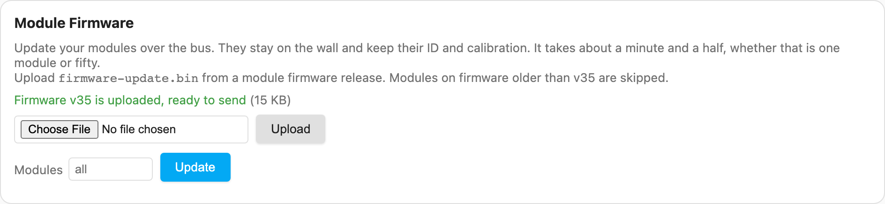

# Updating module firmware over the bus

From module firmware **v35** every module carries a bootloader: a kilobyte at the start of its
flash that can replace the firmware from an image sent over RS-485. The gateway can therefore
update a whole wall in about a minute, without taking a module off the wall and without a UPDI
programmer *(gateway v4.0)*.

A module keeps its **ID and its calibration** through an update: the bootloader never writes
EEPROM. It never starts a half-written image either, so a module that loses power part way
through simply waits for the image to be sent again.

## What you need

- **A gateway on firmware 4.0.0 or later** — the version badge in the dashboard header says
  which one you have, and it updates [from its own Settings tab](SplitFlap-Gateway.md#updating-the-gateways-firmware).
- **Modules on firmware v35 or later.** Older ones have no bootloader. The gateway skips them
  and tells you, and they are not disturbed by the update traffic: their firmware only acts on
  lines beginning with `m` or `~`, and update frames begin with `#`.
- **The image**: `firmware-update.bin` from a module firmware release. Exactly 15,360 bytes,
  240 pages of 64. The gateway checks the image's own CRC before storing it, so a truncated
  download cannot reach a wall.

Getting the bootloader onto a module in the first place takes **one last flash over UPDI**.
That image reserves the first kilobyte of flash with the `BOOTEND` fuse, which has to match
the image — `0x04` from v35, `0x00` before it — so the
[web flasher](https://avandeputte.github.io/SplitFlapUniversalFirmware/), which reads the
right value out of the image, is the easiest way to do it; by hand, see
[Flashing Modules](Flashing-Modules.md#the-fuses-and-why-they-come-first). After that every
update can go over the bus.

## Doing it

**Modules ▸ Module Firmware** on the dashboard. Upload the image, leave the module list empty
to update everything eligible or name the ones you want, and start. The card shows the phase,
the pages as they go out, and a row per module with the version it ran before and runs now.



The gateway keeps the image it was given, and says which version it holds, so the same one
can be sent again — to a module that was powered down during a run, or to a module added to
the wall later — without uploading it twice.

Over REST ([full reference](Gateway-API.md#the-modules-own-firmware-over-the-bus-v40)), the
same thing:

```bash
curl -X PUT --data-binary @firmware-update.bin http://<gateway>/api/modules/firmware
curl -X POST -H 'Content-Type: application/json' -d '{}' \
     http://<gateway>/api/modules/firmware/start
curl http://<gateway>/api/modules/firmware/status
```

## What happens, and how long it takes

| Step | What it does |
|---|---|
| Into update mode | A checksummed command, which is the only form a module accepts for this, so noise on the wire can never take a wall off the air |
| Confirm | Each module is asked whether it is waiting in its bootloader |
| The pages | All 240 broadcast **once**, for every module at a time, so four modules cost the same as one |
| Check | Each module reports which pages it actually wrote *and read back*; only the gaps are resent, per module, for up to five passes |
| Go | A module starts the image only when it holds every page and the whole image matches its CRC |
| Come back | Each module is asked what it now runs |

A run is about **80 seconds**, mostly the pages, **however many modules you are updating**:
eighteen modules measured at 83 seconds, three at 72. The gateway reserves the bus for the
whole time, and nothing else can use it until the run ends.

**A module takes about 30 seconds to answer again** after it starts the new firmware: it
restarts, re-checks the image, waits out the staggered start-up that stops a wall drawing its
inrush at once, and homes its reel. Silence in that window is normal, and the gateway waits it
out before deciding anything.

## Cancelling

A run can be cancelled, and it stops within a few seconds. Be clear about what it leaves
behind, though: once a module has taken its first page it no longer holds a valid firmware, so
its targets stay in their bootloaders with their reels blank, and after eight seconds without
bus traffic they forget which pages they had received.

That is the bootloader refusing to start a half-written image, not damage. **Run the update
again** and they recover, which takes a normal run's time. A module in that state reports
*reason 2* to the probe, meaning it has no valid firmware to go back to.

Cancelling before the first page is sent is free: those modules return to the firmware they
have.

## When something goes wrong

- **A module that stays in its bootloader** did not get the whole image. Run the update again;
  it keeps what it already holds. The probe (`POST /api/modules/firmware/probe`) says which
  image it has and how many pages.
- **A module that answers nothing at all**, neither its bootloader nor its firmware, is the
  case to look at the trace for. Every frame of the run is in it.
- **To leave update mode without changing anything**, send the go before any page has been
  sent: the module returns to the firmware it already has.

The bootloader itself is never overwritten, so a module can always be recovered over UPDI with
the web flasher if anything else fails.

---
**Related:** [Module Firmware](Module-Firmware.md) · [Bus Protocol](Bus-Protocol.md) ·
[Module Diagnostics](Module-Diagnostics.md) · [SplitFlap Gateway](SplitFlap-Gateway.md)
