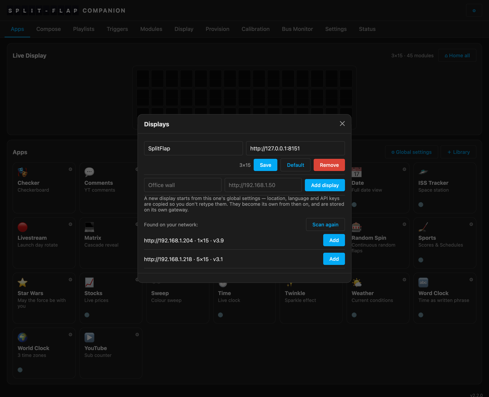

# Multiple displays

One companion can drive **several walls**. A split-flap in the living room and a
[Matrix Gateway](Matrix-Gateway.md) in the office; two split-flaps in different rooms; a
real wall and an emulator you test against. Each has its own geometry, its own apps, its own
playlists, triggers and settings.

If you only own one display, none of this applies — the switcher only
appears once there is a second wall.



## Adding one

**⚙ → Displays → Add display.** Give it a name and its gateway's URL. That's the whole thing.

You usually don't even need the URL: opening the Displays dialog **scans the network for
gateways** and lists what it finds — `url · rows×cols · version` — with a one-tap **Add**
(walls you already drive are filtered out; **Scan again** re-runs it). The scan probes the
subnets the companion can see for the gateway fingerprint (`GET /api/config`), plus mDNS
where multicast reaches it, so it works from inside the Home Assistant add-on and Docker
too. It runs only while that dialog is open — never in the background.

The new display starts from the current one's **global settings** — location, language, API
keys are copied across so you don't retype them. From that moment they are its own: change the
location on one wall and the other keeps its own.

You can also declare them up front, which is the natural thing to do in Home Assistant or
Docker. **`GATEWAY_URL` takes a comma-separated list:**

```yaml
GATEWAY_URL: "http://192.168.1.220,http://192.168.1.221"
```

The first is the default display. Entries in that list only ever **add** a wall — a display you
created in the UI is never removed just because it stopped appearing in the environment.

## Switching between them

A **switcher** appears in the header once you have more than one. It picks which wall the whole
UI is talking about: the live preview, the Apps tab, Compose, Playlists, Triggers, and the
gateway's own tabs all follow it.

Your choice is remembered per browser, so the tablet on the kitchen wall can sit on one display
while your laptop drives another.

## Which wall is "the default"?

Anything that doesn't *name* a display drives the **default** one — Home Assistant's original
entities, a [Vestaboard](Vestaboard-API.md) client, an [MCP](MCP-Server.md) call with no `display`
argument. Set it with **Make default** in the Displays dialog.

This is what lets a single-display setup work without ever naming a display, and what stops your
existing automations breaking the day you hang a second wall.

## How each interface addresses a wall

| interface | how you pick the display |
|---|---|
| The web UI | the header switcher |
| The REST API | `?display=<id>` on any `/api/…` route (an unknown id is a 404) |
| The gateway's own UI | `/gw/<id>/…` — served through the companion |
| [Home Assistant](Home-Assistant.md) | one **device per wall**; the default keeps its historic entity ids, the others are suffixed |
| [Vestaboard API](Vestaboard-API.md) | `/local-api/<id>/message` (plain `/local-api/message` is the default wall) |
| [MCP](MCP-Server.md) | a `display` argument on every tool; `list_displays` tells an agent what exists |

## Where the settings live

Each display's settings are **mirrored to its own gateway** (the companion's local file is
the primary copy, synced on every change — the default `mirror` store), so a rebuilt
companion recovers every display's settings from its wall. The one thing that lives only on
the companion is custom apps you uploaded — keep `<data_dir>/apps/` if you sideload.

That is a deliberate constraint and it is worth understanding, because it is what makes the
next paragraph true: if the machine running the companion dies, you can rebuild it, point it at
the same gateways, and every wall comes back with its apps, playlists, triggers and settings
intact — because each wall was carrying its own.

The list of displays is mirrored to **every** gateway, so recovering any one of them recovers
the whole set.

---
**Next:** [Companion →](Companion.md) · [Home Assistant](Home-Assistant.md)
