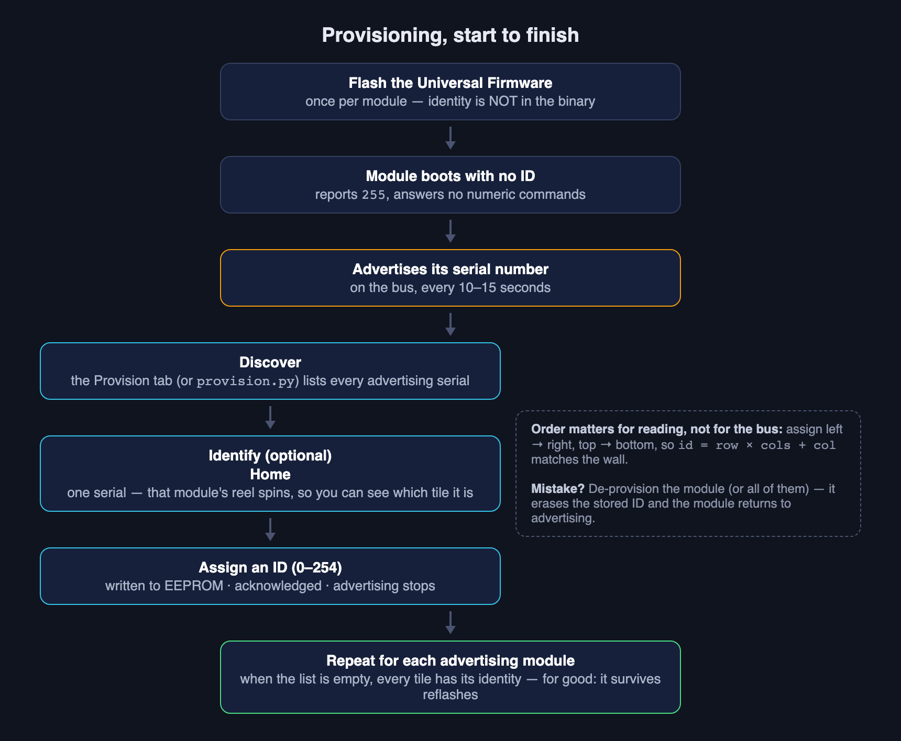
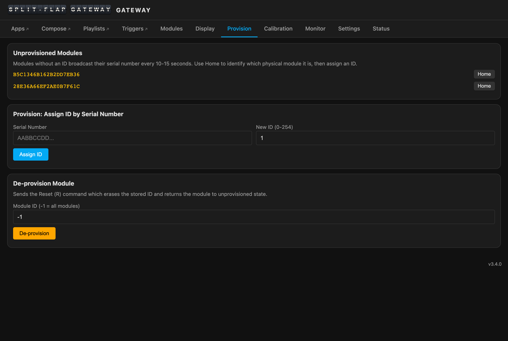

# Module provisioning

Provisioning gives each split-flap module its **bus ID** — the number every command on the
wall addresses it by. It is the middle step of the module pipeline: **[flash](Module-Firmware.md#1-flash)
→ provision → [calibrate](Calibration.md)**. The short version lives in
[Module-Firmware §2](Module-Firmware.md#2-provisioning); this page is the full process, with
every tool that can do it.

> **Only real split-flap hardware needs this.** The [Matrix Gateway](Matrix-Gateway.md)'s
> modules are born provisioned — there is nothing to assign, and you can skip this page
> entirely.

---



## What provisioning is

Every ATtiny1616 leaves the factory with a unique serial number burned into its signature
row (SIGROW). The firmware reads it at boot and formats it as a **20-character uppercase
hex string** — e.g. `A3F24C0018E7D29B3F01`. That serial is the module's permanent, unforgeable
name. The bus ID is the *assigned* one, and a freshly flashed module doesn't have it yet.

An **unprovisioned** module (it reports ID `255`):

- does **not** respond to numeric ID commands, and never answers broadcast queries;
- instead **advertises its serial number** on the bus roughly every **10–15 seconds**:

  ```
  mXadv:A3F24C0018E7D29B3F01
  ```

  The interval is randomised per module (seeded from the serial), so a wall of fresh
  modules powered on together doesn't collide; each module also waits for 20 ms of bus
  silence first, and advertisements pause during broadcast sweeps.

Provisioning assigns a **bus ID (0–254)**. The module writes it to EEPROM, acknowledges,
**stops advertising**, and from then on answers every `m<ID>…` command. Because the
[EESAVE fuse](Module-Firmware.md#1-flash) is set at flash time, the ID **survives reflashing** —
you provision once, not once per firmware update.

Why it works this way: identity is assigned at runtime, over the bus, so **every module
runs the identical binary**. Nothing is compiled in per module, and you never touch the IDE
again after the first flash.

Three tools can do the assigning, and they all speak the same
[provisioning frames](Bus-Protocol.md#provisioning-commands-mx): the **SplitFlap Gateway**'s
Provision tab, **splitflap-os**'s built-in UI, and the firmware repo's `provision.py`
terminal tool. Pick whichever is in front of you.

---

## In the SplitFlap Gateway



The point-and-click way. Open the [SplitFlap Gateway](SplitFlap-Gateway.md)'s web UI
(its `splitflap-gw-xxxxxx.local` address, or the IP) and go to the
**[Provision tab](SplitFlap-Gateway.md#the-web-ui-tab-by-tab)**.

### 1. Discover

Power the wall and wait. The **Unprovisioned Modules** card fills in as advertisements
arrive — one row per module, showing its serial number. A module advertises every 10–15
seconds and the list refreshes about every 10 seconds, so with many fresh modules give it
half a minute to settle. (The Modules tab shows the same modules too, sorted after the
provisioned ones.)

### 2. Identify

Serial numbers don't tell you *which tile on the wall* is which. Each row in the list has a
**Home** button: click it and the SplitFlap Gateway sends `mXH<serial>` — only the matching
module homes, its reel spins to the blank flap, and you can see exactly which physical tile
it is. Every other module ignores the frame.

### 3. Assign

In the **Provision: Assign ID by Serial Number** card, enter the serial and the new ID
(0–254), then **Assign ID**. On the bus that is `mXI<serial>:<id>`; the module writes the
ID to EEPROM, stops advertising, and acknowledges with `mXack`. The SplitFlap Gateway marks
it **provisioning-confirmed**, reads back its firmware version a moment later (the module
needs a beat to settle on its new ID, so the query is delayed and retried), and the module
slots into the Modules grid in ID order.

Repeat — identify, assign — until the list is empty.

### Which IDs to use

Assign **left to right, top to bottom**, starting at 0. Everything downstream — the Display
tab's live wall, text distribution, the Calibration picker, the Companion — assumes
row-major addressing:

```
id = row × cols + col
```

So on a 3 × 15 wall the top row is 0–14, the middle row 15–29, the bottom row 30–44. You
*can* use any numbering, but matching the grid is the difference between "type text, read
text" and a permanent mental crossword.

### Undo

The **De-provision Module** card sends the `R` reset: enter an ID to de-provision that one
module, or `-1` for **all modules on the bus**. See [Starting over](#starting-over) below
for exactly what that does.

### If two modules end up on the same ID

Assign the same ID twice (easy to do mid-wall) and both modules will answer it — their
replies collide, and the SplitFlap Gateway sees version replies with intact framing but a
garbled serial. Repeated corruption like that latches a **DUP?** badge on the module's card
(and the Calibration picker warns before nudging it, since a nudge could move or save the
wrong module). The fix is the `R` command's best feature: **de-provision that one ID** —
both modules process it, both return to advertising — then re-assign each to its own ID.
The badge clears on the next clean read.

---

## On bare metal with provision.py

No SplitFlap Gateway on the bus? The Universal Firmware repo ships
**[`provision.py`](https://github.com/avandeputte/SplitFlapUniversalFirmware/blob/main/provision.py)**,
a terminal tool that does the same job from any machine with a USB-to-RS-485 adapter. It
was written with a Raspberry Pi in mind, but any Linux or macOS box works (it needs a POSIX
terminal for its raw-mode hotkeys). Requirements: Python 3.9+ and
[pyserial](https://pypi.org/project/pyserial/) (`pip install pyserial`).

```bash
python3 provision.py [--port PORT] [--baud BAUD]
```

| Argument | Default | Description |
|---|---|---|
| `--port` | `/dev/ttyUSB0` | Serial port of the USB-to-RS-485 adapter |
| `--baud` | `9600` | Bus baud rate — must match the firmware (9600 8N1) |

Once running, the script listens continuously for advertisements. While idle it takes two
single-key hotkeys (no Enter needed — the terminal is in raw mode):

| Key | Action |
|---|---|
| `d` | Open the de-provision menu |
| `q` | Quit |

### The interactive flow

The first time a module's advertisement arrives, the script opens a dialog:

```
────────────────────────────────────────────────────────────
  New module detected
  Serial : A3F24C0018E7D29B3F01
────────────────────────────────────────────────────────────
  Home this module now to identify it? [y/N]
```

1. **Identify (optional)** — answer `y` and the script sends `mXH<serial>`; that module's
   reel spins to the blank/home flap so you can spot the tile. All other modules ignore it.
2. **Assign an ID** — enter a number 0–254, or `s` to skip (the module keeps advertising
   and the dialog reopens on its next advertisement). The script warns if you enter an ID
   already used this session.
3. **Confirm** — the script sends `mXI<serial>:<id>` and waits up to 2 seconds for the
   module's `mXack`. Success (or a timeout warning) is printed, and the script goes back to
   listening for the next module.

The same [ordering advice](#which-ids-to-use) applies: left to right, top to bottom,
`id = row × cols + col`.

### De-provisioning from the script

Press `d` at any time:

```
  IDs provisioned this session:
     38  →  A3F24C0018E7D29B3F01
     42  →  B10055FFA3C2918D7E44

  Options:
    Enter a module ID (0–254) to de-provision that module
    Enter 'all' to de-provision every module on the bus
    Enter 's' to go back
```

- **One module** — enter its ID; the script sends `m<id>R` after confirmation. IDs from
  previous sessions work too, even though they aren't in the list. The module's serial is
  cleared from the seen-list, so its provisioning dialog reopens when it next advertises.
- **All modules** — enter `all`; after a warning prompt the script broadcasts `m*R`. Every
  module erases its ID, starts advertising, and gets a fresh dialog as each advertisement
  arrives.

`provision.py` drives exactly the frames the SplitFlap Gateway does — `mXadv` in,
`mXH` / `mXI` out, `mXack` back, `R` to reset. The wire-level spec for all of them is in
[Bus Protocol](Bus-Protocol.md#provisioning-commands-mx), and since the bus is plain ASCII at
9600 baud you can also type them by hand from any serial terminal.

---

## In splitflap-os

If [splitflap-os](Using-splitflap-os.md) drives your wall, provisioning is built into its own
UI — similar in spirit to the SplitFlap Gateway's Provision tab, and doing the same thing
on the bus. Follow its documentation for the specifics.

---

## Starting over

Mis-numbered a column? Renumbering the wall? De-provisioning is cheap and safe:

- `m<ID>R` de-provisions **one module**; `m*R` de-provisions **every module on the bus**.
  Both the SplitFlap Gateway's De-provision card and `provision.py`'s `d` menu are
  front-ends for exactly these frames.
- The module erases **only its stored bus ID**. **All calibration is preserved** — home
  offset, steps per revolution, the per-flap map, the flap set — so re-provisioning never
  means re-calibrating.
- The module returns to the unprovisioned state and **resumes advertising within
  ~10–15 seconds**; whichever tool is listening picks it up again like a brand-new module.

Assign the new IDs and you're done. (Don't confuse `R` with the factory reset `F`, which is
the opposite trade: it wipes calibration but *keeps* the ID.)

---

## Canonical sources

This page summarises the firmware repo's own documentation — when in doubt, the repo wins:

- [README.md](https://github.com/avandeputte/SplitFlapUniversalFirmware/blob/main/README.md)
  — the *Module Identity and Provisioning* and *Boot Sequence* explainers, the provisioning
  command reference, and the `provision.py` usage guide
- [provision.py](https://github.com/avandeputte/SplitFlapUniversalFirmware/blob/main/provision.py)
  — the tool itself; its docstring documents the CLI and the frames it sends

---
**Before this:** [Module-Firmware](Module-Firmware.md) — flashing the Universal Firmware ·
**Next:** [Calibration →](Calibration.md)
