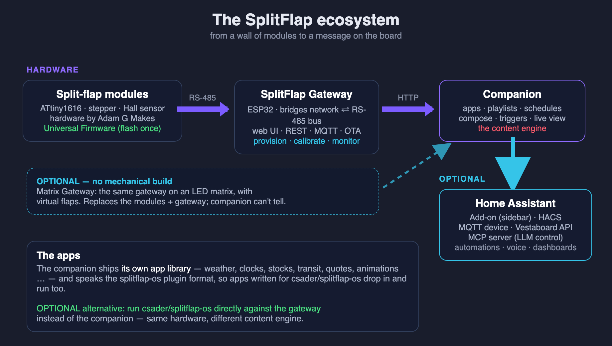

# Quick Start

The whole journey, from parts to a message on the wall — with every **optional** step
marked, so you can see the shortest path to *your* setup.



## Two ways to begin

|  | **A — Real split-flap wall** | **B — LED matrix (no mechanical build)** |
|---|---|---|
| You build/source | Adam G Makes' modules | one Waveshare ESP32-S3-RGB-Matrix board + a HUB75 panel |
| Steps 1–4 below | all of them | **skip to step 4** |
| The result | clacking mechanical flaps | virtual flaps on an LED matrix |

Path B is the fastest way to see the entire stack working. Everything from step 5 on is
identical for both. (These aren't the only mixes — **[Choosing a Configuration](Choosing-a-Configuration.md)**
compares every viable combination, including splitflap-os-based ones.)

---

## Step 1 — Build the modules  *(Path A only)*

Build or source the split-flap modules from **Adam G Makes'**
[SplitFlapDisplay repo](https://github.com/adamgmakes/SplitFlapDisplay) — the PCB, printed
parts, BOM and assembly. The modules **clip onto a DIN rail**; pogo pins on each module
contact a conductor rail carrying 12 V, ground and the two RS-485 bus signals, so mounting
a module is all the wiring there is. See **[Hardware](Hardware.md)**.

## Step 2 — Flash each module  *(Path A only)*

Flash the **[Universal Firmware](Module-Firmware.md)** to every module (same binary for all)
with a [flasher you build from a USB-serial adapter](UPDI-Flasher.md). No compiler needed: the
[web flasher](https://avandeputte.github.io/SplitFlapUniversalFirmware/) does it from Chrome
or Edge with nothing installed, and the prebuilt `firmware.hex` plus `avrdude` do it in two
commands per module — fuses once per chip (so the EEPROM survives), then the firmware.
→ **[Flashing Modules](Flashing-Modules.md)**

Do this once. From firmware **v35** the modules carry a bootloader, so every later version
goes out from the gateway [over the bus](Module-Firmware-Updates.md) instead — the whole wall
in about eighty seconds, with nothing to unmount.

## Step 3 — Provision & calibrate  *(Path A only)*

Easiest from the gateway's web UI once step 4 is done: **assign each module a bus ID**
(Provision tab) and **calibrate** it (Calibration wizard). → **[Module Firmware](Module-Firmware.md#2-provisioning)**

## Step 4 — Set up the Gateway  *(everyone)*

**Path A:** flash the ESP32 gateway over USB. **Path B:** flash the
**[Matrix Gateway](Matrix-Gateway.md)** instead — same steps from here on, no
modules to provision.

A fresh gateway knows no WiFi, so it **raises its own access point** to get you started:

1. Join the WiFi network **`Split-Flap-GW`**, password **`12345678`**.
   *(Matrix Gateway: the AP is named after its hostname, e.g. `splitflap-gw-a3f19c`.)*
2. Open **http://192.168.4.1** → **Settings → WiFi** → enter your SSID and password →
   **Save WiFi**. It reboots onto your LAN and the setup AP disappears.
3. Reconnect your phone/laptop to your own WiFi and open
   **http://splitflap-gw-xxxxxx.local** — the exact name is printed in the boot log and
   matches the host in your router's device list.

> **`.local` not loading?** mDNS doesn't work on every network (different VLAN, guest/IoT
> SSID, blocked multicast, Windows, VMs, containers). Find the gateway's **IP address** in
> your router's DHCP/attached-devices list — look for the host **`splitflap-gw-xxxxxx`** — and use
> `http://<that-ip>` instead. Give it a **DHCP reservation** while you're there.
> → **[Finding it on your network](SplitFlap-Gateway.md#finding-it-on-your-network)**

Then set **rows × columns** in **Settings → Display Layout**, and use the **Display** tab to
send text — the wall should move. → **[SplitFlap Gateway](SplitFlap-Gateway.md)**

> ✅ **Checkpoint:** you can show text from the gateway's web UI. The hardware works. If you
> only wanted a manually-driven display, you're done.

## Step 5 — Run the Companion  *(optional, recommended)*

Bring the display to life with apps, playlists and schedules. Point the companion at your
gateway (`GATEWAY_URL`) and open its UI. → **[Companion](Companion.md)**

```bash
docker run -d --name splitflap-companion -p 8000:8000 \
  -e GATEWAY_URL=http://192.168.1.42 -v companion-data:/data \
  ghcr.io/avandeputte/splitflap-gateway-companion:latest
```

Use the gateway's **IP** here — a container often can't resolve `.local`. Then open
**http://<docker-host>:8000**, run a clock or weather app, build a **playlist**, set a
**schedule**. The gateway now shows a **Companion** tab, and the companion shows the
gateway's tabs.

> **Running Home Assistant?** Don't use Docker — install the companion as an **App** instead
> (step 6). It's the same software, with the config UI and the sidebar done for you.
>
> Prefer csader's original engine? See **[Using splitflap-os](Using-splitflap-os.md)**.

## Step 6 — Home Assistant  *(optional)*

Two pieces, and they're independent — install either or both.

### 6a. The Companion as an **App** (the UI, in the sidebar)

> Home Assistant renamed add-ons to **Apps**. Requires a Supervisor install (HA OS or
> Supervised) — Home Assistant *Container* users should use the Docker command in step 5.

1. **Settings → Apps → App Store** → the **⋮** menu (top right) → **Repositories**.
2. Paste `https://github.com/avandeputte/SplitFlapGatewayCompanion` → **Add** → **Close**.
3. The store now lists **SplitFlap Gateway Companion** (stable) and a **Beta** entry. Pick
   one → **Install** (it pulls a prebuilt image; no build).
4. Open the **Configuration** tab and set **`gateway_url`** — e.g. `http://192.168.1.42`.
   *(Use the IP; the add-on container may not resolve `.local`.)*
5. Back on the **Info** tab: turn on **Show in sidebar**, then **Start**.
6. **Open Web UI** — the companion, inside Home Assistant.

### 6b. The **HACS integration** (entities & automations)

1. In **HACS**, open the **⋮** menu → **Custom repositories**.
2. Repository `https://github.com/avandeputte/SplitFlapGatewayCompanion`, type
   **Integration** → **Add**.
3. Search HACS for **SplitFlap** → **Download** → **restart Home Assistant**.
4. **Settings → Devices & Services → + Add Integration → SplitFlap**, and enter the
   **companion's** URL (not the gateway's) — `http://<companion-host>:8000`. Running it as
   an App? Use the App's own address, shown on its Info tab.

You get **App** and **Playlist** selects, a **Showing** sensor, Clear/Stop/Home buttons, and
a `splitflap.message` service with timed auto-revert:

```yaml
action:
  - service: splitflap.message
    data:
      text: "Welcome home"
      seconds: 20
```

There's also an MQTT device, a Vestaboard-compatible API, and an MCP server for LLM control.
→ **[Home Assistant](Home-Assistant.md)** for all five.

---

## The shortest paths

- **"I just want to see it work"** → Path B (Matrix Gateway) → step 4 → step 5. No soldering.
- **"Real flaps, driven by hand"** → steps 1–4. Skip the companion.
- **"Real flaps, full experience"** → steps 1–6.
- **"I use Home Assistant"** → get the gateway working (step 4), then install the companion
  as an app (step 6) — it's the easiest way to run it.

---
**Reference:** [FAQ & Glossary](FAQ.md)
