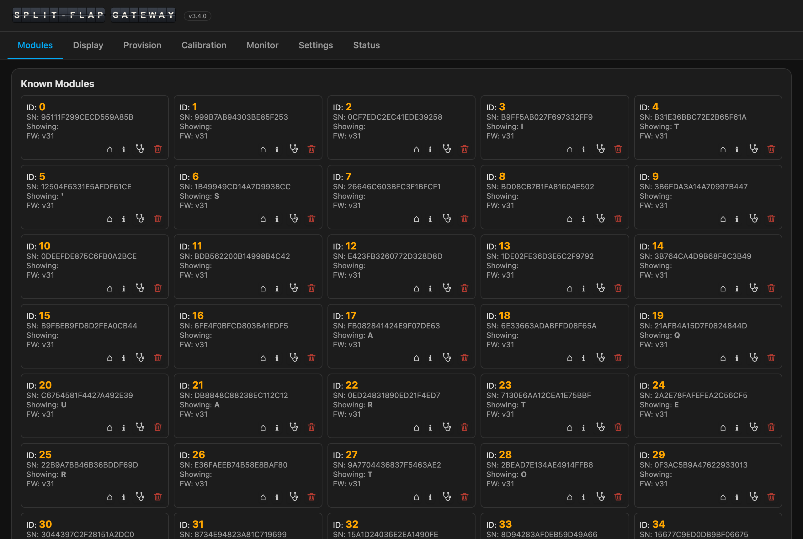
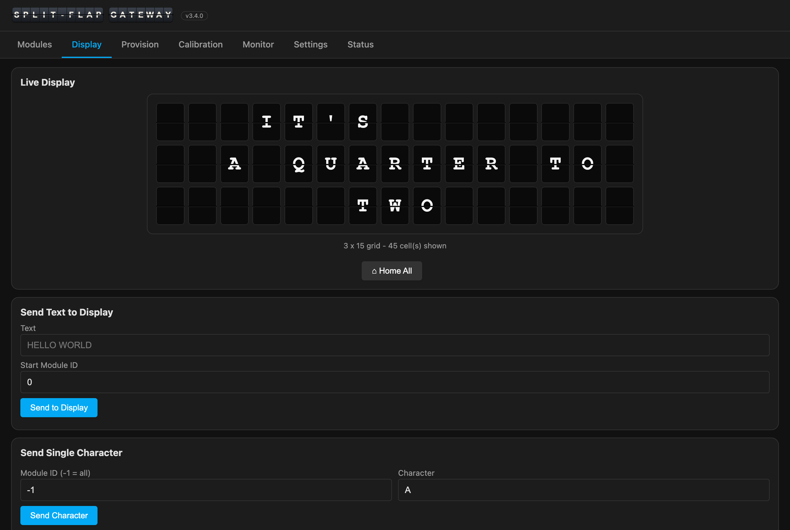

# SplitFlap Gateway

The gateway is the **ESP32 controller** that sits between your network and the split-flap
bus. It owns everything about the hardware — discovering modules, provisioning, calibration,
diagnostics, and driving the flaps — and serves a single-page **web UI** to do all of it. It
has no notion of "a weather app" or "a playlist"; that's the [Companion's](Companion.md) job.

> **Repo:** [github.com/avandeputte/SplitFlapGateway](https://github.com/avandeputte/SplitFlapGateway)
> · board: Waveshare **ESP32-S3-RS485-CAN** (RS-485 transceiver on board) · reach it at
> **http://splitflap-gw-xxxxxx.local** (six hex digits unique to the board — printed at
> boot) — or by IP, [see below](#finding-it-on-your-network)

## 1. Flash it

Two ways:

- **Prebuilt binary (no toolchain):** download from the repo's Releases. On a blank board,
  flash **`firmware.factory.bin`** at address `0x0` — either with the browser tool at
  [espressif.github.io/esptool-js](https://espressif.github.io/esptool-js/) or
  `esptool --chip esp32s3 write_flash 0x0 firmware.factory.bin`. If it won't program, hold
  **BOOT**, tap **RESET**, release **BOOT**, and retry. (Use a USB-C **data** cable.)
- **Build from source:** VS Code + PlatformIO, open the folder with `platformio.ini`,
  Build → Upload. PlatformIO fetches the ESP32 toolchain and libraries automatically.

The first flash must be over USB. Every update after that can be done **over WiFi (OTA)**
from the Settings tab — upload the app-only `firmware.bin` (never the factory image).

## 2. Join it to WiFi

The gateway ships with **no WiFi credentials**, so it can't be on your network yet. It
solves that itself: whenever it is *not* connected as a station, it raises its own **fallback
access point** — on first boot, and again any time it later loses your WiFi.

1. From a phone or laptop, join the WiFi network **`Split-Flap-GW`** — password
   **`12345678`**. (It's an open-to-anyone-nearby setup AP, which is why it goes away as
   soon as the gateway is on your LAN.)
2. Browse to **http://192.168.4.1** — the gateway's full web UI, served by the AP itself.
3. **Settings → WiFi**: enter your network's **SSID** and **password**, then **Save WiFi**.
4. The gateway reboots, joins your LAN, and the setup AP **shuts off** — so your phone drops
   back to your normal WiFi. Reconnect your phone/laptop to your own network and carry on
   there.

> **2.4 GHz only.** The ESP32 has no 5 GHz radio. If your router publishes one SSID for both
> bands, it's usually fine — but if the gateway can't see your network, that's the first
> thing to check.

### Finding it on your network

Once it's on your LAN, the gateway advertises itself over **mDNS** as
**http://splitflap-gw-xxxxxx.local**, where  is six hex digits unique to this
board — the name is printed in the boot log, and it's the same name your router's device
list shows. (Firmware before 3.11 used plain `splitflap-gw`, which collides the moment a
second gateway joins the LAN.) That's the easy address — but mDNS is a *best-effort*
convenience, not a guarantee. It commonly doesn't resolve when:

- your client is on a **different VLAN / subnet** from the gateway (mDNS doesn't route), or
  the network has an isolated **IoT/guest SSID**;
- the router or AP **blocks multicast / "client isolation"** is on (common on mesh systems);
- you're on **Windows**, on a **Docker container** or a **VM**, or on a corporate VPN — none
  of which reliably resolve `.local`;
- a **Home Assistant container** is doing the lookup (this is why the companion's
  `gateway_url` is often happier with an IP).

**If the `.local` name doesn't load, use the IP address instead.** To find it:

- **From the gateway itself** — while still on the setup AP, the **Status** tab shows the IP
  it got. Or watch the USB serial console at boot (115200 baud); it prints the IP.
- **From your router** — open its admin page and look at the DHCP client / "attached
  devices" list for a host named **`splitflap-gw-xxxxxx`**. This is the most reliable route, and
  while you're there it's worth giving the gateway a **DHCP reservation** so the address
  never changes.
- **By scanning** — `dns-sd -B _http._tcp` (macOS) lists every `splitflap-gw-*` on the
  network; or `arp -a`, or `nmap -sn 192.168.1.0/24`
  on your subnet.

Then use `http://<that-ip>` everywhere this guide shows a `.local` gateway address —
including the companion's `GATEWAY_URL` / `gateway_url`. A reserved IP is the setup least
likely to surprise you later.

## 3. Set the grid

In **Settings → Display Layout**, set **rows × columns** to match your wall (e.g. 3 × 15).
This drives the live display and the calibration picker — and the [Companion](Companion.md)
reads it from here, so you set the grid **once**, on the gateway.

## The web UI, tab by tab

- **Modules** — a grid of every known module: ID, serial, the character it's showing, and
  firmware version. The list is *sticky* — it survives reboots and only drops a module after
  6 hours unseen. Each card has **⌂ Home**, **ℹ Info** (live query + the module's stored home
  offset, steps/rev, flap map — editable on newer module firmware), and a **🗑** menu (erase
  EEPROM / factory reset / de-provision). **↻ Identify All** rediscovers the bus.
- **Display** — a live render of the wall, a **Home All** button, and boxes to send text
  across the modules, a single character (to one module or broadcast), or a specific flap by
  index.
- **Provision** ([full guide](Provisioning.md)) — discover unprovisioned modules, home one by serial to identify it
  physically, assign IDs, and de-provision. (This is the UI for [provisioning](Module-Firmware.md#2-provisioning).)
- **Calibration** ([full guide](Calibration.md)) — a picker grid matching your layout: edit and save each module's home
  offset and total steps, nudge live, **Count Steps**, tune the per-flap map, and run a
  guided **Calibration Wizard**.
- **Bus Monitor** — live decoded RS-485 traffic with timestamps, pause / auto-scroll, a
  **Download Log** button, and a **Send Frame** box (with a **Raw** option) for hand-crafted
  commands.
- **Settings** — WiFi, MQTT, Timezone, **Quiet Time schedule**, the **Companion App**
  registration, Display Layout, Home Assistant, OTA update, and calibration backup/restore.
- **Status** — network, system health (uptime, heap, per-task stack), the RS-485 bus
  counters, the clock (RTC + NTP), and whether the companion is checked in.

## What else the gateway offers

- **REST API** — a full JSON API, documented endpoint by endpoint in
  [Gateway API](Gateway-API.md) (machine-readable spec: the repo's `openapi.yaml`). The one
  the companion leans on most is `POST /api/rs485/batch`: a whole page of flaps in a single
  request, which is what keeps animations smooth with no broker involved. The raw bus
  frames all of it wraps are specified in [Bus Protocol](Bus-Protocol.md).
- **MQTT** — optional; publishes bus traffic and a periodic status blob, and subscribes to
  command topics. Default prefix `splitflap`, port 1883.
- **Home Assistant discovery** — opt-in on the Settings tab (needs MQTT). Creates a gateway
  device with a Display text entity, Maintenance/Quiet switches, and a set of diagnostic
  sensors. *(This is the gateway's own HA device — the companion adds more; see
  [Home Assistant](Home-Assistant.md).)*
- **OTA** — update over WiFi after the first USB flash, from Settings or `http://<ip>/ota`.

## The Companion tab

When you run the [Companion](Companion.md) and point it at the gateway, it **registers**
itself: a **Companion** tab appears in the gateway's nav, and the companion's own nav gains
the gateway's tabs — each side advertises what it has, so the navigation always matches both
halves. A container companion can even store its settings *on the gateway*, so it stays
stateless.

---
**Next:** [Companion →](Companion.md) — or, no hardware? [Matrix Gateway →](Matrix-Gateway.md)
